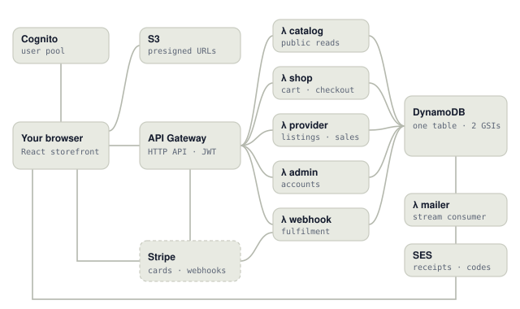

# SoftHub

A serverless marketplace for software licences on AWS. Providers list desktop software and subscriptions; buyers pay by card and receive licence keys by e-mail within seconds, then download installers from their library. Reviews are scored for sentiment and summarised per aspect, and every product page recommends related products.

**Live demo:** https://sundarrajnitish.github.io/SoftHub-Lab/ is SoftHub itself, with the real backend code running in your browser. Shop as a buyer, pay with a test card and watch the licence key land in the inbox, review what you bought, publish a product from a studio, run the platform as an admin, and open “Behind the scenes” to see each click travel through API Gateway, Lambda, DynamoDB, Stripe and SES.



## What it does

| Who | Can |
| --- | --- |
| Visitor | Browse and search the catalogue, read reviews and the "what buyers say" summary, see related products |
| Buyer | Cart, checkout with card (3-D Secure supported), licence keys by e-mail, library with time-limited download links, one verified review per product |
| Provider | Create, edit (optimistic locking), publish and archive listings; upload images and installers straight to S3; 30-day sales, payout and sentiment dashboard |
| Admin | Platform metrics; find users by e-mail; suspend or reinstate accounts (enforced on every call, even for tokens already issued) |

## Architecture

```
browser ──► API Gateway (HTTP API, Cognito JWT authorizer)
              ├─► λ catalog   public reads, 60 s in-container catalogue cache
              ├─► λ shop      cart · checkout · orders · library · reviews
              ├─► λ provider  listings · uploads · dashboard
              ├─► λ admin     accounts · metrics
              └─► λ webhook   Stripe events → fulfilment
                      │
                      ▼
              DynamoDB (one table, GSI1 + GSI2, streams, TTL)
                      │ stream: OUTBOX# inserts
                      ▼
              λ mailer ──► SES (receipts with licence keys)

Stripe ◄── PaymentIntents (λ shop), confirm (browser) ──► signed webhooks ──► λ webhook
Cognito ── user pool, groups Consumer / Provider / Admin, post-confirmation trigger
S3 ── presigned PUT (provider uploads), presigned GET (5-minute downloads)
```

All business logic lives in [`packages/core`](packages/core/src): plain JavaScript with no dependencies, so the same code runs on Lambda, in Node, and in the browser. [`services/aws`](services/aws/src) holds the thin adapters (DynamoDB, Stripe, SES, S3, Cognito, Secrets Manager) and the Lambda entry points. [`infra/template.yaml`](infra/template.yaml) is an AWS SAM template **generated from the route table**, so the deployed API cannot drift from the code.

### Design decisions

| Decision | Why |
| --- | --- |
| The server prices the cart | The client never sends an amount. Checkout snapshots line prices into the order; later price edits never touch an open order. |
| Licences come only from the signed webhook | A forged "payment succeeded" from the browser, a closed tab or a lost response can neither grant nor lose a licence. |
| `Idempotency-Key` on checkout | A double click or a retry returns the same order and PaymentIntent, never a second charge. |
| One DynamoDB transaction per fulfilment | Order status, licence keys, ownership, cart cleanup, product counters, the provider's sales ledger, platform counters and the e-mail outbox commit together, conditioned on the order state and on the Stripe event id. Duplicates and stale events change nothing. (≤ 100 items per transaction, hence the 15-item cart.) |
| Outbox row + table stream for e-mail | The receipt is sent if and only if the order is paid, and retried by the stream (with a dead-letter queue) if SES fails. |
| Roles are Cognito groups set server-side | Sign-up may request Consumer or Provider; Admin is granted by hand. Suspension is checked on every authenticated call (30 s cache). |
| Single-table design | Every page is one `GetItem` or one-partition `Query`; nothing scans. See the access patterns in [`keys.js`](packages/core/src/keys.js). |
| Optimistic locking on listings | Two editors cannot silently overwrite each other; the stale save gets `409`. |
| Archive, never delete | Buyers keep licences and order history when a listing is withdrawn. |
| Presigned S3 URLs | Files never pass through Lambda (6 MB payload limit). Downloads need an active licence and expire after 5 minutes. |
| Deterministic licence keys | `SHUB-XXXXX-XXXXX-XXXXX-XXXXX` = 90 bits of HMAC(order, product, buyer) + a two-symbol checksum mod 1021: retries yield the same key, keys cannot be forged, and every single typo or adjacent swap is caught offline. |
| Lexicon sentiment, computed once at write time | Explainable, sub-millisecond, deterministic; product aggregates are exact integer counters that edits adjust by deltas and the audit can recount. |

### Data model (one table)

| Entity | PK | SK | Indexes |
| --- | --- | --- | --- |
| Product | `PRODUCT#<id>` | `META` | GSI1 `CAT#<category>` / `<name>#<id>` (published only) · GSI2 `PROVIDER#<sub>` / `PRODUCT#<id>` |
| Review | `PRODUCT#<id>` | `REVIEW#<reviewId>` (time-sortable) | — |
| One-review-per-buyer marker | `PRODUCT#<id>` | `REVIEWER#<sub>` | — |
| Co-purchase counter | `PRODUCT#<a>` | `ALSO#<b>` | — |
| Profile | `USER#<sub>` | `PROFILE` | GSI1 `EMAIL#<email>` / `USER` |
| Cart line / ownership | `USER#<sub>` | `CART#<productId>` / `OWNS#<productId>` | — |
| Order / order line | `ORDER#<id>` | `META` / `LINE#<productId>` | GSI1 `USER#<sub>` / `ORDER#<id>` |
| Sales ledger | `PROVIDER#<sub>` | `SALES#<day>#<productId>` | — |
| Platform counters | `PLATFORM` | `DAY#<day>` | — |
| Idempotency / Stripe event / outbox | `IDEMP#…` / `EVENT#<id>` / `OUTBOX#<orderId>` | `META` / `META` / `EMAIL` | TTL on the first two |

## Run it

Requires Node.js 22+.

```bash
npm ci --prefix services/aws      # AWS SDK + Stripe for the adapters (tests import them)
npm test                          # unit, API, adapter, template and whole-system audit tests
npm run simulate                  # experiments → results/summary.json + docs/data/results.js
npm run eval:sentiment            # sentiment metrics on the dev and held-out sets
npm run dev:api                   # local API on :8787, the whole cloud in one process
cd web && npm ci && npm run dev   # React storefront; without VITE_API_URL it runs the backend in the tab
```

### Deploy to AWS

```bash
node scripts/gen-template.mjs                 # (already generated; CI checks it)
sam build -t infra/template.yaml
sam deploy --guided                           # parameters: AppUrl, MailFrom (a verified SES identity)
```

Then:

1. Put the Stripe keys in the generated secret (`SecretArn` output): `{"stripeSecretKey": "sk_…", "stripeWebhookSecret": "whsec_…", "licenseSecret": "<keep the generated value>"}`.
2. In the Stripe dashboard, add the `StripeWebhookUrl` output as an endpoint for `payment_intent.succeeded`, `payment_intent.payment_failed`, `payment_intent.canceled` and `charge.refunded`.
3. Build the storefront with `web/.env` from [`web/.env.example`](web/.env.example) (`VITE_API_URL`, `VITE_USER_POOL_ID`, `VITE_USER_POOL_CLIENT_ID`, `VITE_STRIPE_PUBLISHABLE_KEY`) and host `web/dist` on S3 + CloudFront or Amplify Hosting.
4. Grant admins by hand: `aws cognito-idp admin-add-user-to-group --group-name Admin …`.

## Results

From `npm run simulate` (seeded, so re-runs reproduce the numbers; latencies are modelled, see [`latency.js`](packages/core/src/latency.js)).

**Fulfilment under webhook chaos** — about 200 orders per run through the real API, then a 13-point audit that recounts licences, ownership, counters, the sales ledger, charges, refunds and e-mails from scratch:

| Scenario | Deliveries | Duplicates absorbed | Failed attempts (retried) | Seconds to licence p50 / p95 | Audit |
| --- | ---: | ---: | ---: | ---: | --- |
| calm | 200 | 0 | 0 | 0.9 / 1.4 | 13/13 |
| 10 % duplicates | 219 | 19 | 0 | 0.9 / 1.5 | 13/13 |
| every event twice | 406 | 203 | 0 | 0.9 / 1.4 | 13/13 |
| endpoint down on first try | 414 | 0 | 207 | 5.9 / 6.5 | 13/13 |
| storm: duplicates + failures + 20 s jitter | 381 | 128 | 82 | 4.6 / 19.7 | 13/13 |

**Launch day** — 2,400 shopping sessions shaped like a Montréal evening with a 7 pm spike: 21,242 requests, 290 orders, 1.3 % of requests on a cold container; catalogue p50 15 ms, checkout path p95 380 ms (includes the Stripe call). About US$0.07 of AWS per day (≈ US$2.10 a month at that rate).

**Sentiment** — 84.8 % accuracy (macro-F1 0.80) on 99 held-out reviews written and labelled for this project; stars and text agree on 94 % of generated 4–5★ and 1–2★ reviews, and the rest are flagged to providers.

**Recommendations** — content similarity plus half the co-purchase cosine; the right product is in the top five for 44.2 % of 353 simulated shoppers when their latest purchase is held out.

## Repository layout

```
packages/core/src/      domain + API: catalogue, shop, provider, admin, webhook routes;
                        table port + DynamoDB emulator; auth; payments; licences;
                        sentiment; recommendations; local runtime; whole-system audit
services/aws/src/       Lambda handlers and AWS/Stripe adapters
infra/template.yaml     AWS SAM (generated by scripts/gen-template.mjs)
web/                    React storefront (Vite)
sim/                    simulator and sentiment evaluation
data/                   labelled review sets (dev / held-out test)
tests/                  node:test suites
docs/                   interactive site (GitHub Pages, /docs), core copied by scripts/build-site.mjs
results/                simulator output
```

## Credits

Designed and built by Nitish Sundarraj. Every product, studio and person in the demo catalogue is fictional; product artwork is generated from names. Fonts on the site: Bricolage Grotesque, Instrument Sans and JetBrains Mono (SIL Open Font License, via Google Fonts). Pricing figures: AWS and Stripe public price lists, October 2026.

## Licence

MIT — see [LICENSE](LICENSE).
